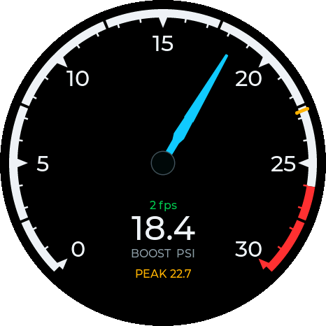
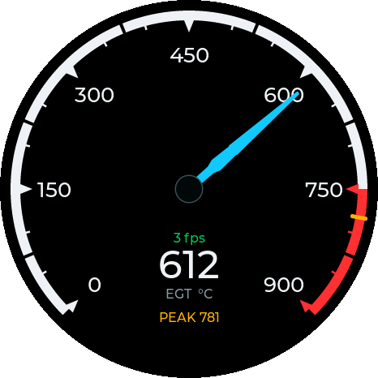
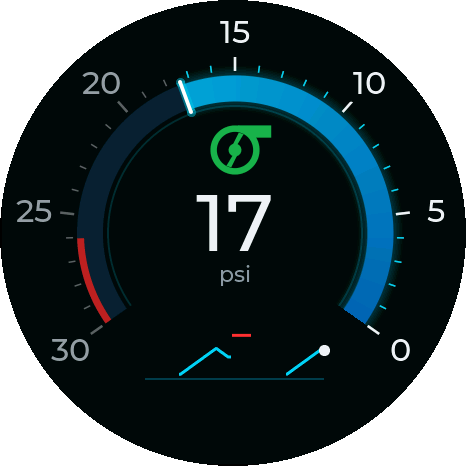
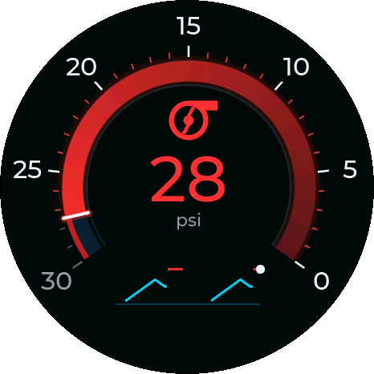
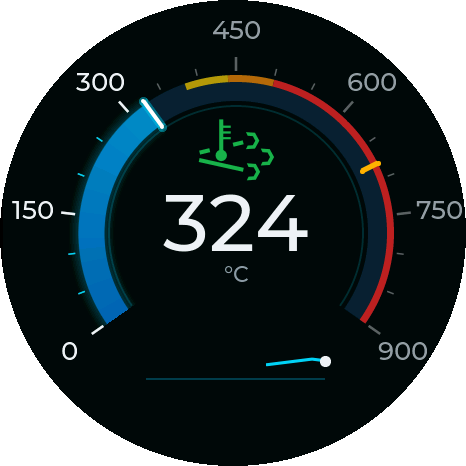
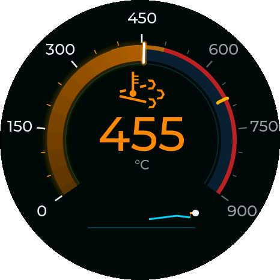

# Shipped Gauge Faces

The faces in `firmware/assets/gauges/`, and the compiled-in fallback, and why they look the way they
do.

| File | Look | Generated |
|---|---|---|
| `boost.xml` | PX Ranger style, 0–30 psi, redline 26 | `tools/faces/px_faces.py` |
| `egt.xml` | PX Ranger style, 0–900 °C, yellow 380 / orange 440 / red 500 | `tools/faces/px_faces.py` |
| `boost_modern.xml` | Modern style (lit arc, mirrored), 0–30 psi, redline 26 | `tools/faces/modern_faces.py` |
| `egt_modern.xml` | Modern style (lit arc), 0–900 °C, yellow 380 / orange 440 / red 500 | `tools/faces/modern_faces.py` |
| `boost_custom.xml` | Hand-written test face for every custom-shape feature | no |
| built-in fallback (`gauge_config_default.c`) | PX boost face with the built-in needle | `px_faces.py --default` |

**Edit the generator and regenerate; do not edit the generated XML or C string.** Each script holds
its style's proportions, and its outputs have to stay one design. `modern_faces.py` takes its icons
and alert colours from `px_faces.py`, so the two styles share them.

Every face is picked the same way: Settings → Faces lists every file on the gauge, and the editor
can upload any of them. A gauge updated over the air does not get new shipped faces on its storage
(OTA writes the app, not LittleFS): open them from the editor's examples, which ship in the app
image, and upload them.

## The PX Ranger style

The owner's vehicle is a PX Ranger, so the faces match its instrument cluster. Two sources:

- **The PX3 tachometer**, photographed in the car: `images/rpm-gauge-px3.jpg` in the owner's
  `obd-display` repository, with its written summary in that repository's
  `docs/px3-ranger-instrument-design-reference.md`. The markings, proportions and layout come
  from here.
- **The `obd-display` dashboard**, the owner's in-car display for the same vehicle. The palette
  (`Styles/Colors.axaml`, its `ipc-*` tokens) and the needle outline (`NeedleGaugeView.axaml`) come
  from here, so the two displays in the car speak one visual language.

What was carried over, measured on the photo as fractions of the ring's outer radius R (220 px here):

| Feature | Tacho | Here |
|---|---|---|
| Scale ring | Thick off-white ring near the rim, broken at each half-major | 7 bands, 12 px (5.5% R), 1.4° gaps, in `#b0b4b6` (dimmed, see below) |
| Redline | Ring turns red; pointers in it are red | Ring splits to `#cc2626` at the redline; `band-color` pointers |
| Major marks | Small inward triangle hanging off the ring, no line ticks | Custom major-tick shape: 13 px wide, 16 px deep |
| Minor marks | Short bars off the ring between numerals | 2.5 × 6 px bars, every 1 psi / 50 °C; red in the redline |
| Numerals | White, every major, ~0.8 R, single digits | `montserrat_32` at 172 px (boost); EGT's three-digit numbers use `montserrat_26` at 166 px to keep the same clearance |
| Caption | "RPM x 1000", ~0.5 R above centre | "BOOST  PSI", "EGT  °C", under the readout (see below) |
| Needle | Pale cyan taper with a stepped neck from a black cap | `obd-display`'s needle outline (body minus its black cover), `#17caff`, dark cap with a `#46525a` rim (darker is lost on black) |
| Background | Black | `#000000`, which is also what an AMOLED wants |

### Deliberate departures

- **An icon above the hub says what the gauge measures** (2026-11-27): a turbo's compressor housing
  for boost, and for EGT Ford's own *High Exhaust System Temperature* telltale (a thermometer in an
  exhaust stream with three puffs), redrawn from a reference the owner supplied, in Ford's telltale green `#1fb24a`, turning the
  alert red and flashing with the needle past the redline, about
  60 px across, centred at y 162 (`<icon>`). The cluster's telltales are symbols, not words. The
  needle passes over it, which is fine for static artwork.
- **The unit sits under the readout** ("PSI", "°C"), in `montserrat_22` and a muted `#8f9aa0`, not ~0.5 R
  above centre. Boost and EGT spend most of their time in the upper-left of the sweep, so a
  caption there was crossed by the needle constantly; below the hub it labels the number instead.
  The lower half reads top-down as value, unit, (peak, when turned on), sparkline.
- **Sized for the A-pillar** (2026-11-27). The gauge is read at a glance from the driver's seat, so
  the readout is an 80 px whole number (`montserrat_digits_80`, top at y 258), the caption 22 px
  (centre 342), and the peak figure, when the user turns it on, 20 px at y 356. Nothing on the dial
  is smaller than the numerals except that optional peak figure.
- **A sparkline** (`<trend>`, 200 × 50 px at y 378) fills the gap under the dial: the reading over
  the last 30/60/120 s across the face's range, its line coloured by zone (cyan, then yellow,
  orange or red where the reading was in that zone).
- **EGT zones** (2026-11-27, the owner's limits): yellow from 380 °C, orange from 440, red above
  500, on the ring and pointers and as alerts. Yellow and orange are steady; red flashes. The
  needle, readout and icon take the zone's colour. Ring colours are dimmed to 80% like the
  redline; alerts are full brightness.
- **Dimmed static artwork, against AMOLED burn-in** (2026-11-27). The ring, pointers and numerals
  are `#b0b4b6`, 75% of the cluster's `#ebf0f2`, and the redline ring `#cc2626`, 80% of `#ff3030`.
  Those pixels never move, so they wear while the black around them does not; the needle and
  readout, which do move, stay at full brightness and lead the eye. Pixel shift does the rest
  ([ADR 0014](adr/0014-glanceable-burn-in-aware-dial.md)).

- **The needle stops at 180 px** rather than reaching the ring as on the tacho. That is the built-in
  needle's footprint, the size the 60fps budget was measured at, and the editor warns beyond it.
  The shaped `boost_custom` needle is not much bigger and costs about 6 fps (see
  [performance.md](performance.md)).
- **No glow.** The cluster and `obd-display` both put a soft halo on the needle and the hub rim. The
  renderer has no blur, and a faked halo ring looked worse than none.
- **Montserrat, not Ford's typeface.** The device fonts are LVGL's built-in Montserrat. The
  cluster's condensed numerals would need a converted font, and Ford Antenna is not licensed for
  that.
- **A digital readout and peak value** sit in the lower half, where the tacho has its coolant
  sub-dial. A single-purpose gauge needs the number.
- **The fallback face uses the built-in needle**, in the PX cyan. It is the last line of defence, so
  it stays on the longest-tested drawing path (asserted in `tools/host-tests/test_gauge_config.c`).

The alert behaviour is unchanged from the previous faces: above the redline, the readout and needle
flash red at 2 Hz.

 

These screenshots predate the 2026-11-27 layout (bigger readout, sparkline, dimmed ring); retake
them on hardware. Screenshots taken with `tools/remote/gauge_remote.py` while values were pushed over UDP telemetry;
the green fps counter is the display overlay, stalled by the screenshot itself.

## The Modern style

Two faces after the obd-display **Modern dashboard's arcs** (`ArcGauge.cs`, laid out in
`ModernDashboardView.axaml`; *The Modern dashboard* and *The arcs and the foot rail* in its
`docs/desktop-app-architecture.md`; palette from `Styles/Colors.axaml`). Rendered by the `<arc>`
element ([ADR 0016](adr/0016-arc-fill-faces.md)), not by porting the Avalonia control.

 

 

On the gauge, 2026-11-28, values fed over UDP telemetry.

| Dashboard | Here |
|---|---|
| A thick band in place of a needle, fading from `IpcBlue` #0065b0 to `IpcCyanBright` #00d2f0 | 26 px band, outer edge at 158 px, same colours. The fade runs along the **scale**, not along the fill (see below) |
| A glow of five faint passes reaching 2–10 px past the band | An analytic glow, 21% at the band's edge falling to 0 at 10 px, computed per pixel once |
| A white head bar, 3.5 px over a 9 px halo of the fill at 45% | `#ffffff` 4 px over a 9 px halo at 45% |
| The whole fill amber or red past the thresholds, fading up from 35% of that colour | The same, from the face's alerts: boost red above 26; EGT yellow from 380, orange from 440, red above 500. Steady; the readout and icon flash in red as on the PX faces |
| Warning and danger as a slim stripe on the band's outer edge (`#b0ffb000`, `#d0e62323` over the track) | 7 px stripes, the tints pre-mixed over the track `#0b2031`: yellow, orange and red for EGT |
| A hairline guide inside the band (`#3300bee1`) | A 2 px band at radius 128 (a 1 px arc breaks up on the panel), `#042d36` |
| Ticks outside the band, majors 0.55 × band long, minors half; lit (white, minors in the fill colour) once passed | 14 and 7 px shaped ticks hanging outward from radius 162; lit as a whole as the fill reaches each |
| Numerals outside the ticks in `IpcGrey`, white once passed | `montserrat_32` (boost) and `montserrat_26` (EGT, three digits) in `#969ea2`, swapped to `#ebf0f2` |
| The boost arc mirrored, running anticlockwise | `start-angle="125" sweep="-250"` |
| The RPM arc clockwise | EGT, clockwise, so a pair of gauges reads as the dashboard's two arcs |
| Near-black ground `#05090b`, nothing boxed | The same. On the AMOLED it is close to off, and nothing on the face has a box |

Kept from the PX faces, at the same sizes ([ADR 0014](adr/0014-glanceable-burn-in-aware-dial.md)): the icon
above the readout (green, alert colour and flashing past the redline), the 80 px readout, the unit
under it (22 px; `psi` lower case, as on the dashboard), the optional peak figure under that, the
sparkline coloured by zone in the gap between the arc's ends (180 px wide there), the peak marker
across the band, and the brightness from the OBD Display link (it is global, not a face setting).

### Deliberate departures

- **The fade is fixed to the scale.** On the dashboard the fade is a conic gradient stretched over
  the fill, so its head is always the full colour. On the gauge that would recolour every lit pixel
  on every frame; fixed to the scale, a moving value redraws only the slice it moved through. At
  low readings the head is therefore a darker blue than on the dashboard; the white head bar is
  still the brightest thing on the scale.
- **No boost-target marker.** The dashboard's wedge and bar show the PCM's target boost. The gauge
  asks the display for one channel, its face's own ([ADR 0015](adr/0015-obd-display-link.md)), so
  it has no target. Adding it needs a second channel in the link, on both ends.
- **No eased sweep between samples.** The dashboard interpolates linearly between polled boost
  samples. The gauge's own MAP sensor samples at 100 Hz, and the faces' damping (0.88 per 5 ms
  sample, a ~40 ms time constant) smooths the 10 Hz telemetry steps instead.
- **Symmetric arcs.** The dashboard's arcs run 250° from ±135°, leaning toward the page's centre in
  their frames. On a round dial alone they are centred: ±125°.
- **Montserrat, not Ford Antenna**, as on the PX faces.

### Burn-in

The fill lights wherever the reading sits. An EGT cruising at 300 °C keeps the first third of its
arc lit for as long as the drive lasts, where a needle lights a 20 px strip; boost at cruise lights
the first few psi. The fade puts the dimmest colours at the start of the scale, the static artwork
is dim (`#596267` ticks, `#969ea2` numerals, `#0b2031` track), and pixel shift applies as on every
face ([ADR 0014](adr/0014-glanceable-burn-in-aware-dial.md)). The PX faces stay for a driver who
prefers less wear.

## Measured

On hardware, 2026-09-22, needle sweeping, WiFi connected: the PX boost face runs at **61.2–61.8
fps**, 10.8% dirty, 6.5 ms mean render. On the same build, `boost_custom` measured 55.8 fps.

2026-10-01: minor graduations, the larger pointers and the caption move are all in the static
background, pre-rendered once ([ADR 0003](adr/0003-static-background-plus-needle-sprite.md)); the
needle and its dirty box are unchanged. The fps overlay read the same before and after on the
glass, but the needle sweep was not re-measured with the serial log.
